<div align="center">

# 📨 Message Intelligence System

### Spam vs Legitimate message classification using **KNN · SVM · Naive Bayes**


**[🚀 Live Streamlit App](#-links)** · **[🎥 Video Explanation](#-links)** · **[📓 Notebook](Message_Intelligence_System.ipynb)**

</div>


## 🎯 Overview
A **Message Intelligence System** for a communication-security company. It classifies every incoming message as

| Label | Meaning |
|:---:|---|
| `0` | ✅ Legitimate message |
| `1` | 🚨 Spam message |

Three families of classifiers are combined with **probability theory** and compared:

| Family | Model | Idea |
|---|---|---|
| 📏 Distance-based | **K-Nearest Neighbors** | Similar messages have the same label |
| ⚖️ Margin-based | **Support Vector Machine** | Maximum-margin boundary between classes |
| 🎲 Probabilistic | **Gaussian Naive Bayes** | Bayes' theorem + class probabilities |


---

## 🧪 Dataset
| Property | Value |
|---|---|
| Rows × Columns | **5,200 × 16** |
| Target | `spam_label` (0 = legit, 1 = spam) |
| Class balance | ~81% legit / ~19% spam (**imbalanced**) |
| Missing values | ~2–3% in `sender_activity_score`, `sender_account_age_days`, `messages_sent_last_24h` |

**Features:** message length · word count · URLs · digits · special characters · spam keyword score · legit keyword score · sender activity score · account age · messages in last 24 h · hour of day · day of week.

<p align="center">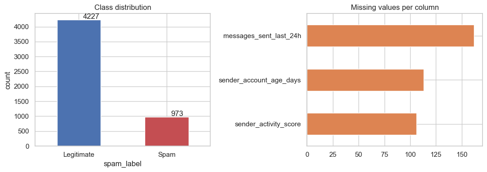<br><i>Class distribution and missing values</i></p>

---

## 🚨 Key Finding: Data Leakage
> `num_special_chars > 0` occurs in **100% of spam** and **0% of legitimate** messages — a single feature is a *perfect classifier*.

With it, KNN, SVM and Naive Bayes all score **100%**, so no comparison is possible. It was **removed from the model inputs (11 features remain)**. The "all features" result is still shown in the notebook as *Scenario A*.

```
spam_label                 0    1
num_special_chars > 0
False                   4227    0
True                       0  973
```

---

## 🛠️ Workflow

| Part | Tasks | What was done |
|:---:|:---:|---|
| **A** | 1–5 | Theory: conditional probability, Bayes' theorem, NB assumptions, KNN & SVM working, distance vs probabilistic vs margin classifiers |
| **B** | 6–8 | Features/target, EDA, leakage check, median imputation, `StandardScaler`, 80/20 stratified split (`random_state=42`) |
| **C** | 9–12 | KNN baseline, K = 1…31 with 5-fold CV, 4 distance metrics, misclassification analysis |
| **D** | 13–15 | SVM Linear / RBF / Polynomial, `GridSearchCV` on C & gamma, support vectors & margin, SVM vs KNN |
| **E** | 16–19 | Gaussian NB, manual conditional probabilities, Bayes' theorem by hand, manual vs `predict_proba` |
| **F** | 20–22 | Accuracy / Precision / Recall / F1, confusion matrices, ROC, PR curves, best model for precision vs recall |
| **G** | 23–24 | Final report, business recommendation, saved models, Streamlit app |

> Preprocessing (imputer + scaler) lives inside a scikit-learn **`Pipeline`**, so it is fitted on training data only — no test-set leakage.

---

## 📸 Screenshots & Results

### 🔹 Part B — Data understanding
<p align="center">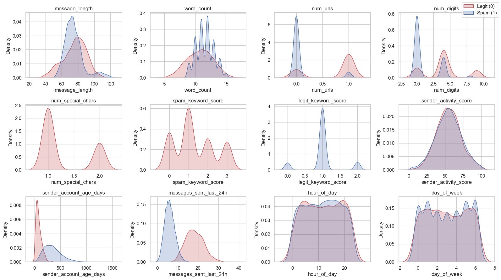<br><i>Feature distributions by class — keyword scores, URLs, digits, account age and 24 h activity separate the classes; time features do not</i></p>
<p align="center">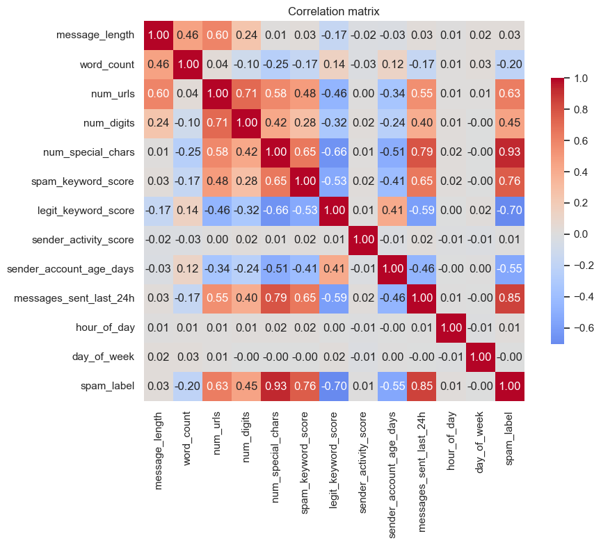<br><i>Correlation matrix — <code>message_length</code> and <code>word_count</code> are correlated (breaks Naive Bayes' independence assumption)</i></p>

### 🔹 Part C — K-Nearest Neighbors
<p align="center">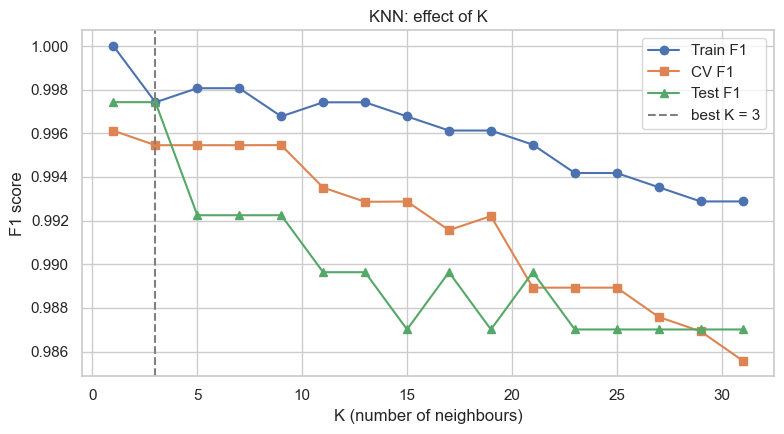<br><i>Effect of K on F1 (train / CV / test) — best K = <b>3</b></i></p>
<p align="center">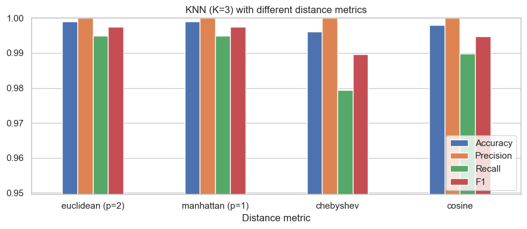<br><i>Distance metrics — Euclidean & Manhattan best, Chebyshev worst</i></p>
<p align="center">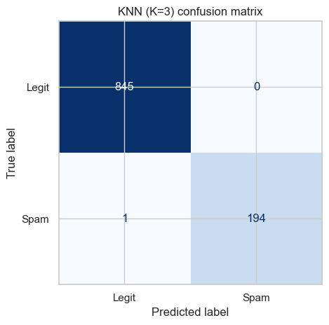<br><i>KNN confusion matrix — only 1 missed spam out of 1,040 test messages</i></p>

> **Why KNN fails:** the single error was a spam message with no keyword, no URL and no digits, and a *missing* `messages_sent_last_24h` that was imputed with a legit-looking median. At K = 31 the errors rise to 5 (all missed spam) because the minority class gets out-voted.

### 🔹 Part D — Support Vector Machine
<p align="center">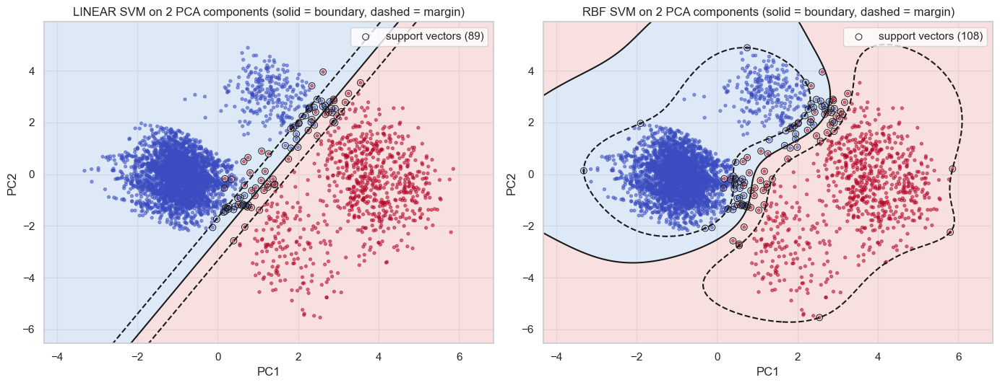<br><i>Margin and support vectors (2-D PCA view) — solid line = boundary, dashed = margin</i></p>
<p align="center">
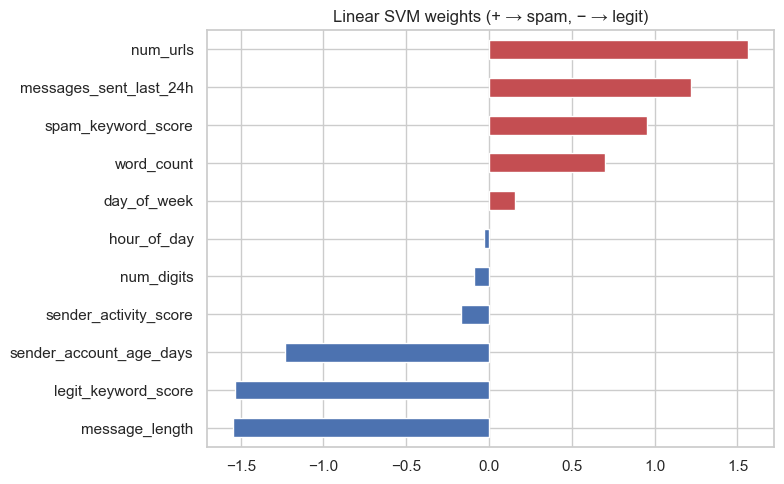
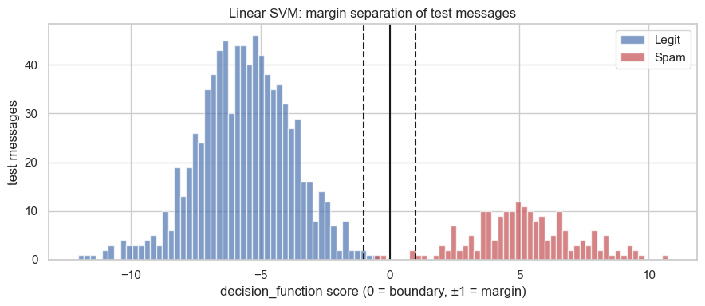<br>
<i>Linear SVM weights (left) and distance of test messages from the boundary (right)</i></p>

| Kernel | Support vectors | % of training data |
|---|:---:|:---:|
| Linear | 20 | 0.48% |
| RBF (tuned, C=100, γ=0.01) | 23 | 0.55% |
| RBF (default) | 158 | 3.80% |
| Polynomial (deg 3) | 99 | 2.38% |

<p align="center">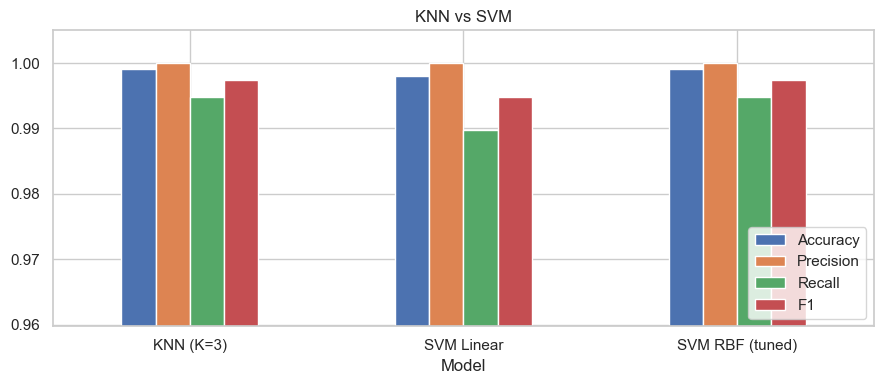<br><i>KNN vs SVM — nearly identical accuracy; SVM predicts ~10× faster</i></p>

### 🔹 Part E — Naive Bayes & probability
Manual Bayes' theorem on a sample message (`URL + spam word, no legit word`):

```
P(Spam)  × P(URL|Spam)  × P(SpamWord|Spam)  × P(¬LegitWord|Spam)  = 0.108439
P(Legit) × P(URL|Legit) × P(SpamWord|Legit) × P(¬LegitWord|Legit) = 0.000002
evidence P(X) = 0.108441   →   P(Spam | X) = 1.0000   →   SPAM
```
<p align="center">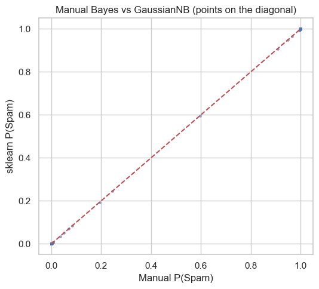<br><i>Manual Bayes calculation vs <code>GaussianNB.predict_proba</code> — all points on the diagonal (max difference ≈ 1e-15)</i></p>

### 🔹 Part F — Evaluation
<p align="center">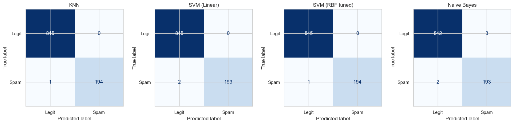<br><i>Confusion matrices — KNN · SVM Linear · SVM RBF · Naive Bayes</i></p>
<p align="center">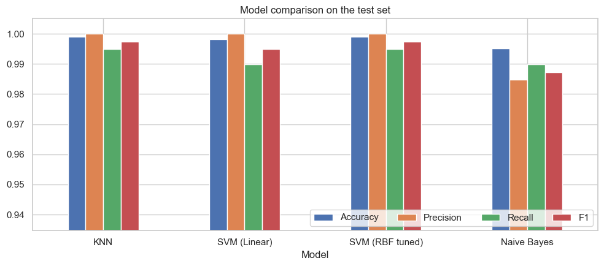<br><i>Accuracy / Precision / Recall / F1 on the test set</i></p>
<p align="center">
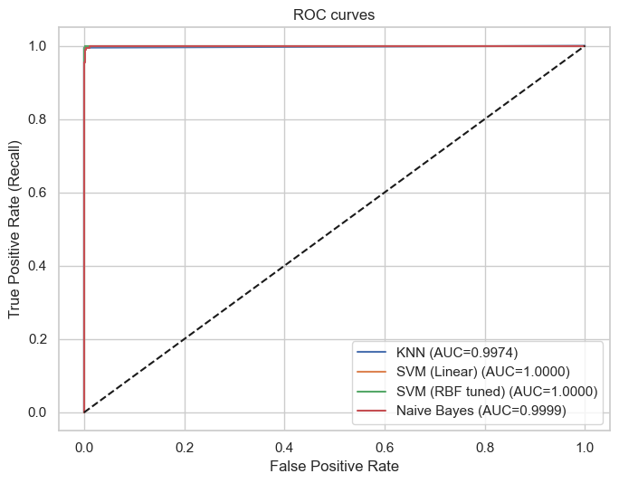
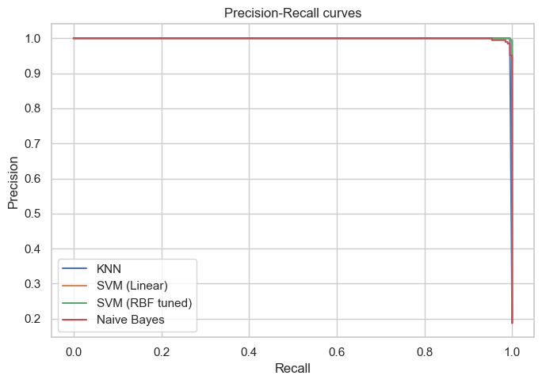<br>
<i>ROC curves (left) and Precision–Recall curves (right)</i></p>

### 🔹 Part G — Naive Bayes over-confidence
<p align="center">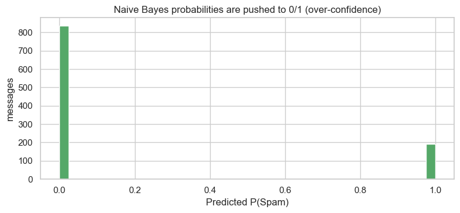<br><i>~99% of Naive Bayes probabilities are pushed to &lt;0.01 or &gt;0.99 — correlated features are counted twice</i></p>

---

## 🏆 Model Comparison

**Test set (1,040 messages, 11 features)**

| Model | Accuracy | Precision | Recall | F1 |
|---|:---:|:---:|:---:|:---:|
| KNN (K=3) | 0.9990 | **1.0000** | **0.9949** | **0.9974** |
| SVM Linear | 0.9981 | **1.0000** | 0.9897 | 0.9948 |
| SVM RBF (tuned) | 0.9990 | **1.0000** | **0.9949** | **0.9974** |
| Naive Bayes | 0.9952 | 0.9847 | 0.9897 | 0.9872 |

**Hard mode — keyword scores removed** (stress test with the easy signals gone)

| Model | Accuracy | Precision | Recall | F1 |
|---|:---:|:---:|:---:|:---:|
| KNN | 0.9846 | 0.9838 | 0.9333 | 0.9579 |
| **SVM (RBF)** | **0.9962** | **0.9948** | **0.9846** | **0.9897** |
| Naive Bayes | 0.9683 | 0.8857 | 0.9538 | 0.9185 |

### 💪 Strengths & weaknesses
| Model | Strengths | Weaknesses |
|---|---|---|
| **KNN** | Simple, no training, adapts locally | Slow prediction, needs scaling, sensitive to K and noisy features |
| **SVM** | Strong generalisation, few support vectors, stable CV | Needs tuning (C, γ); kernels are hard to explain |
| **Naive Bayes** | Fastest, true probabilities, interpretable | Independence assumption broken, over-confident, lowest precision |

---

## 🖥️ Streamlit App
Type a message, adjust sender/time details, pick a model and a spam-probability threshold — or upload a CSV for **batch prediction**.

<p align="center">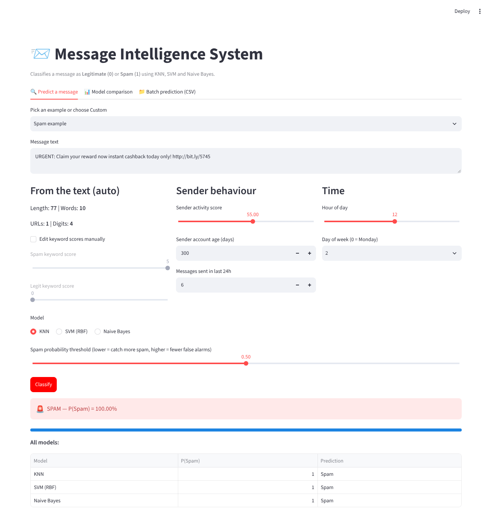<br><i>Predict tab — instant spam probability from all three models</i></p>
<p align="center">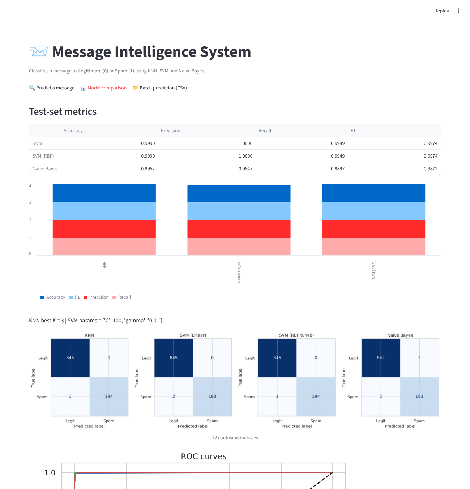<br><i>Model comparison tab</i></p>

---

## 💼 Business Recommendation
1. **Deploy SVM** as the main classifier; keep **Naive Bayes** as a fast second opinion that outputs probabilities.
2. **Choose the threshold by cost** — high *precision* for critical legitimate traffic (OTP, banking, work mail); high *recall* for security/phishing filtering. Send messages with P(Spam) between 0.3–0.7 to **human review**.
3. Keyword scores are easy for spammers to change → **retrain regularly** and keep sender-behaviour features (account age, messages in 24 h, URLs).
4. Track **precision / recall / F1** in production, not accuracy (spam is the minority class).

⚠️ **Limitation:** messages are template-based, so real-world accuracy will be lower. Next step: TF-IDF text features.